# Dragon Ball Z Sparking! METEOR

The **ZENKAI Power!** project aims to provide a complete version of **Dragon Ball Z Sparking! METEOR**, also known as **Dragon Ball Z Budokai Tenkaichi 3**, as if the game had been officially released for PC and mobile. The project also celebrates the different releases of the game by bringing together their unique features into a definitive edition.

## Game Editions

Three localized versions of the game were released on two different consoles between late 2007 and early 2008.

### Sparking! METEOR

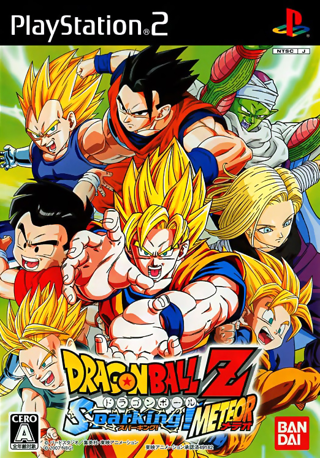

Originally released on October 4, 2007, for the PlayStation 2 and Nintendo Wii. It includes several textures that were changed in the Western releases. Its main distinction is a soundtrack featuring original music from the anime, with four more tracks than the Western versions.

### Budokai Tenkaichi 3

  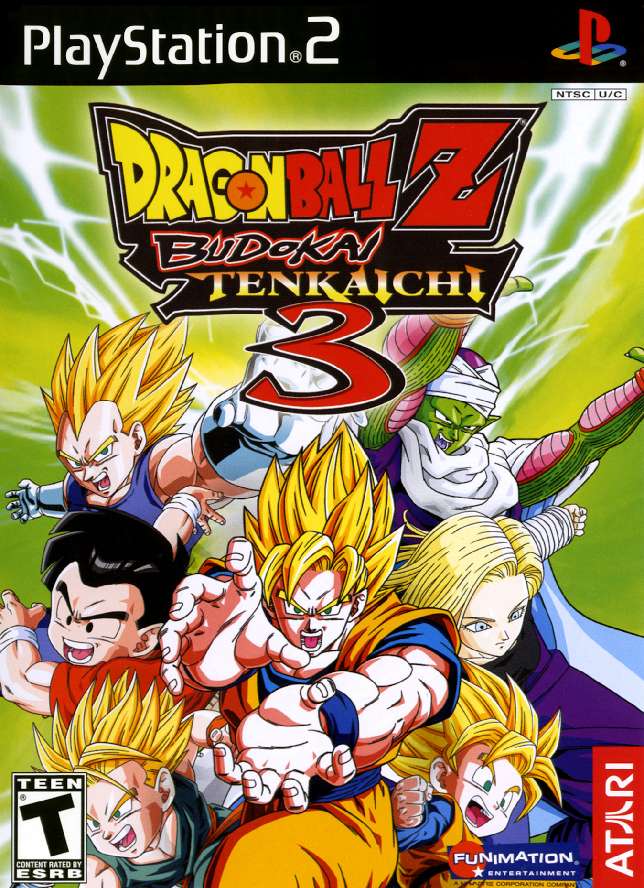
  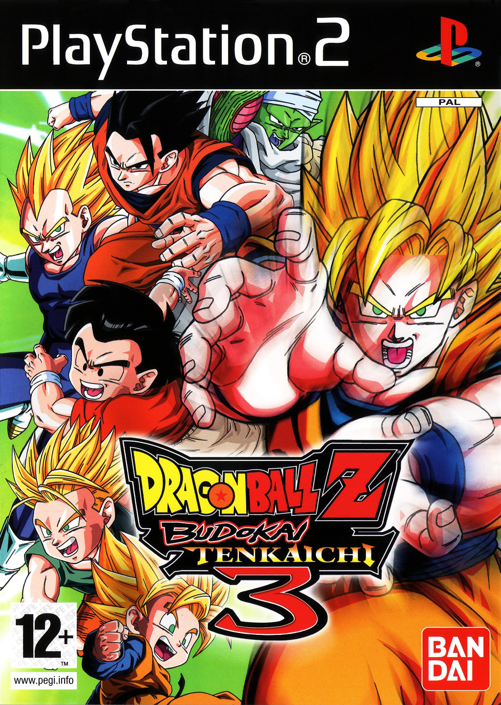

The Western version was released in Europe as PAL and in North America as NTSC. In addition to its different title, this version includes a unique 20-track soundtrack composed specifically for the game, along with an English voice option. Besides the 50 Hz versus 60 Hz refresh rates, the main differences are that the European version includes four additional text languages alongside English: German, Spanish, French, and Italian.

### Nintendo Wii Versions

  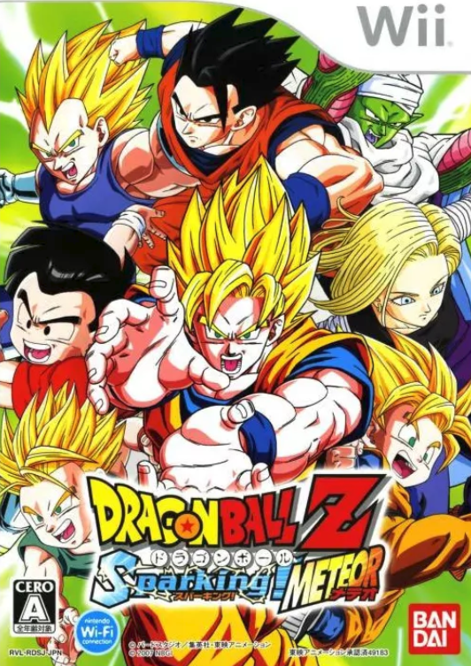
  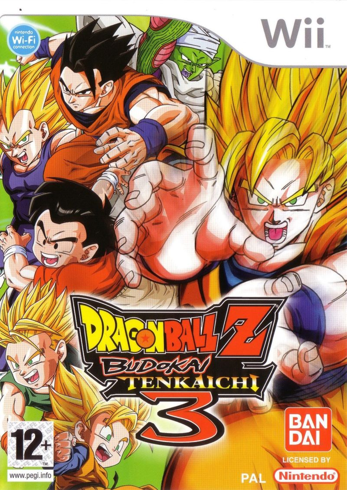

Both **Sparking! METEOR** and **Budokai Tenkaichi 3** (in both Western versions) were also released for the Wii, bringing the total to six official releases. The main addition was Dragon Net Battle, an exclusive game mode unavailable on the PlayStation 2. It allowed players to connect to the *Nintendo Wi-Fi Connection* (WFC) for online battles with friends, including ranked matches.

 The **ZENKAI Power!** project brings the best of these versions together into a single, definitive edition of the game.

## Tenkaichi3Decomp

This project is only possible thanks to the reverse engineering work of [**Tenkaichi3Decomp**](https://github.com/z3xox/Tenkaichi3Decomp), which reconstructed the original game's source code, making it possible to modify the game and add new features. Many thanks to the project's author and all its contributors.

Some of the new features implemented by **Tenkaichi3Decomp** and inherited by **ZENKAI Power!** are listed below.

### Multi-Language and Translations

Support for multiple languages, including the official translations from the European version. 

Fan translations can also be added to the game, although they are not included in the installation package.

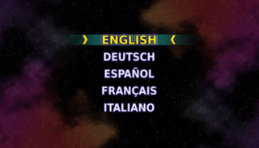

### Alternative Clash Controls

An optional control mode for *clashes* replaces analog stick rotation with repeated presses of the attack button.

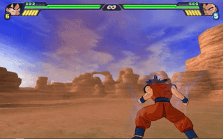

### Disc Fusion

The *Disc Fusion* game modes can be unlocked and played.

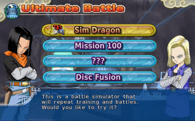

### Autosave

  The game can now save player progress automatically, without requiring manual saves.
  

### Higher 3D Resolutions

3D battles can now be played at resolutions higher than 640×480.

### Texture Replacement

Higher-resolution texture packs can be added to the game.

### Video Options

New video options include *V-Sync*, *Frame Skipping*, and *Frame Interpolation*. These allow the game to run at frame rates above the NTSC version's original 30 FPS.

### Online Multiplayer

The connection method used to connect two players online was adapted from **Tenkaichi3Decomp**.

### Native Text

Menu text previously displayed as texture images has been replaced with native text.

## Added Features

**ZENKAI Power!** also introduces new features to provide a more native PC experience.

### Widescreen Support

Both battles and menus now support widescreen displays, going beyond the original releases' 4:3 aspect ratio.

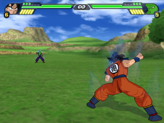

Each menu was carefully adapted by hand for widescreen support, using a different approach from **Tenkaichi3Decomp**. Battles use the same approach as **Tenkaichi3Decomp**.

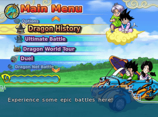

### Keyboard and Mouse Support

Keyboard and mouse support allows the game to be played without a controller. The mouse can also be used to navigate menus.

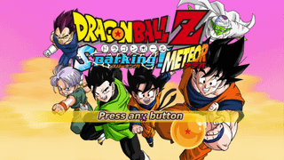

### New Options in the Options Menu

New options have been added directly to the game's Options Menu, providing more ways to configure the game.

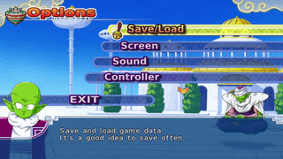

### Game Edition Selection

You can switch between **Sparking! METEOR** and **Budokai Tenkaichi 3**, including each version's exclusive soundtrack and textures.

  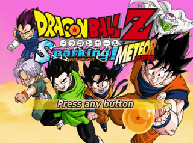
  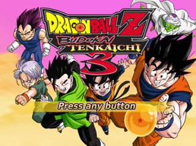

### Starting Characters

Ready to play *Dragon History* one more time?

Inspired by other Dragon Ball games that start with a limited roster and require players to unlock the remaining characters, **ZENKAI Power!** introduces a similar progression. Instead of starting with 132 characters unlocked, you begin with just 10. The rest of those 132 characters can be unlocked through Dragon History.

The remaining characters in the game's full roster of 161 are unlocked as usual, just as in the original releases.

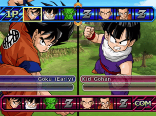

⚠️ An optional fresh save file restores the original starting roster of 132 unlocked characters.

### LAN and Online Multiplayer

*Dragon Net Battle* has been adapted to work over LAN or online. The connection method between two players was adapted from **Tenkaichi3Decomp**.

For LAN play, both players only need to set a player name and connect to the same local network. Casual game modes are available over LAN.

Online play allows players to connect over the internet for casual or ranked matches. Players must create a username and receive a user code for their account. Keep your username and user code somewhere safe, as both are required to log in to online mode.

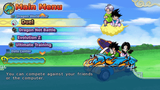

Online mode includes:

- Casual battles
  - 1 vs 1
  - Team Battle
  - 10 DP Team Battle
  - 15 DP Team Battle
  - 20 DP Team Battle
- Ranked battles
  - 1 vs 1
- Global player rankings

Ranked mode uses the game's native scoring system.

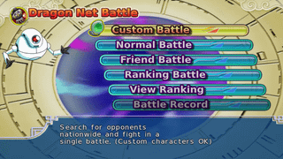

## Mobile Version

**ZENKAI Power!** is available for Android.
A similar project is the **[Tenkaichi3DecompAndroid](https://github.com/dfdx047/Tenkaichi3DecompAndroid)**.

⚠️ It currently requires a device running **Android 10 or later**, an **ARM64 CPU**, and support for **Vulkan**.

### Touchscreen Menus

The game's menus have been adapted for touchscreen devices, similar to the Mouse support on PC.

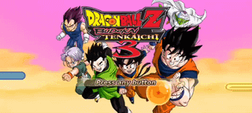

### Virtual Gamepad

During battles, a virtual gamepad can be displayed on the screen, allowing players to control the game without a physical controller.

The virtual gamepad uses original game artwork for the buttons.

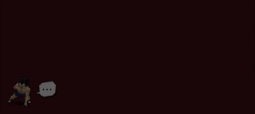

### Gamepad Support

Gamepad support is available for Android devices, allowing players to use a controller instead of the touchscreen.

## Installation

To install the game, you must own a copy of the North American NTSC PlayStation 2 version of **Dragon Ball Z Budokai Tenkaichi 3**. Other versions are optional to add extra content and unlock some of the features listed above, including *Dragon Net Battle*.

⚠️ No game files are distributed with the **ZENKAI Power!** project.

### Desktop

Download the installation files for your platform (Windows or Linux), extract them, and follow the installer's instructions. The installation files are available on the [**releases page**](https://github.com/ZenkaiPower/DBZSM-ZenkaiPower/releases/latest).

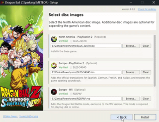

### Android

Download the `.apk` file from the [**releases page**](https://github.com/ZenkaiPower/DBZSM-ZenkaiPower/releases/latest), install it on your Android device, and follow the instructions in the app.

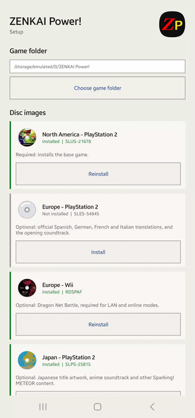

### Versions Supported

- **North America - PlayStation 2** (**Required** `SLUS-21678`): Installs the base game.
- **Europe - PlayStation 2** (Optional `SLES-54945`): Adds the official Spanish, German, French, and Italian translations and restores the game opening soundtrack.
- **Europe - Wii** (Optional `RDSPAF`): Adds the Dragon Net Battle mode, exclusive to the Wii version. Required for playing LAN or online.
- **Japan - PlayStation 2** (Optional `SLPS-25815`): Adds the option to toggle exclusive content from the Japanese version, Sparking! METEOR, including title screen artwork, anime soundtrack, and more.

## Source Code

The **ZENKAI Power!** project's source code will be made available as open source in the future.

## Licenses

**Tenkaichi3Decomp** is licensed under the [GNU General Public License v3.0](https://github.com/z3xox/Tenkaichi3Decomp/blob/main/LICENSE). This license and the other open-source licenses used by **ZENKAI Power!** can be found in the [**licenses**](licenses) folder included in the game's installation package.

## Legal

**ZENKAI Power!** is a game modification project and is not affiliated with or endorsed by Bandai Namco Entertainment Inc. or any other company that holds the copyright to the original game. The project is intended solely for educational and personal entertainment purposes. Distributing copies of the original game or any copyrighted content without proper authorization is strictly prohibited.
